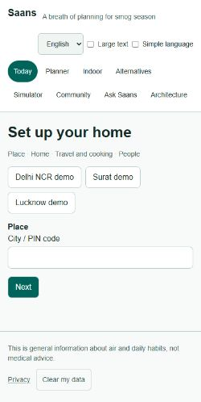
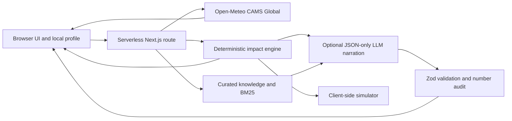

# Saans

Saans helps households and communities make practical choices during winter smog and urban air pollution. It combines live regional forecasts, a deterministic impact engine, household-tailored routines and indoor actions, and optional AI wording in English, Hindi, or Gujarati.

## What works

- City and approximate PIN onboarding with Delhi NCR, Surat, and Lucknow demo profiles.
- Today's PM2.5, PM10, CPCB-style category, and a 48-hour forecast from Open-Meteo's CAMS Global air-quality service. The service documents CAMS global forecast data at 3-hour resolution; Saans displays the returned timestamps as provided. [API documentation](https://open-meteo.com/en/docs/air-quality-api)
- Deterministic daily exposure and emissions estimates, planner, indoor concentration comparisons, and transport/cooking/no-burning trade-offs.
- Room-level advice and curated retrieval sources.
- A client-side impact simulator using the same pure engine module as the server routes.
- On-device pledges, copyable Clean Air Day card, and school or housing-society advisory drafts.
- Grounded chat with cited knowledge, streaming output, cancellation, token-aware memory, and one schema-repair attempt.
- Optional browser speech-to-text in chat with a typed fallback when the browser does not provide speech recognition.
- A small offline navigation fallback. The service worker never caches profile-bearing pages or API responses; forecasts and new guidance need a connection.
- English, Hindi, and Gujarati onboarding and core air brief UI; user language is applied to model responses.
- A labeled demo mode when air data or an LLM is unavailable. Demo readings and fallback wording are never presented as live.

## Mobile preview



## Architecture



See the in-app [`/architecture`](app/architecture/page.tsx) page for the data flow, deterministic vs. generated responsibilities, and requirement-to-file traceability.

### How impact is calculated

`lib/engine/` contains pure functions for indoor steady-state concentration, time-slice exposure, CPCB category mapping, commute factors, and emissions estimates. Outputs are ranges, with an explanation of assumptions. The language model receives structured engine results and may explain them; it does not own or calculate the reported figures.

These are planning approximations, not personal exposure measurements. Room volume, penetration, air exchange, deposition, commute factors, and emissions factors vary by building, product, route, fuel, and behavior. Outdoor air data are gridded forecasts, not a monitor at the household. The cigarette comparison is a rough rule of thumb, not a health-risk equivalence. Review `howCalculated` alongside every result.

## Run locally

Requirements: Node.js 20.9 or newer and npm.

```powershell
npm ci
Copy-Item .env.example .env.local
```

```bash
npm run dev
```

Open `http://localhost:3000`. Air data need no key. The app works without an LLM key using deterministic, labeled fallback wording. The sample configuration uses Groq's OpenAI-compatible API (`LLM_PROVIDER=openai`, `LLM_MODEL=openai/gpt-oss-20b`, and `LLM_BASE_URL=https://api.groq.com/openai`). Add your key as `LLM_API_KEY` in `.env.local`; keep it server-side and never use a `NEXT_PUBLIC_` variable.

If Node reports a certificate verification error on a Windows network with trusted HTTPS inspection, start the app with `NODE_USE_SYSTEM_CA=1` set in the environment. This uses the trusted Windows certificate store and requires Node.js 22.19 or newer.

```bash
npm run lint
npm run typecheck
npm test
npm run test:coverage
npm run build
npm start
```

The build uses Next.js's supported Webpack option with Tailwind's official PostCSS plugin because the supplied Tailwind Turbopack worker failed in this Windows workspace. Pages render per request so the strict CSP nonce reaches Next.js runtime scripts; API handlers remain stateless serverless functions. The project is configured for Vercel in `vercel.json`; API handlers run on Node.js functions in the Mumbai region.

## Serverless and privacy

API requests do not persist a household profile or health details. Profiles, preferences, chat, and pledges stay in local storage unless a user chooses a feature that needs a server calculation. Sharing model context is off by default. Air requests send rounded approximate coordinates to Open-Meteo. The clear-data action removes Saans's local storage keys.

Air responses use Next.js revalidation caching and a per-instance request-coalescing cache. Rate limiting also uses a per-instance in-memory token bucket: it is best-effort demo protection and is not a global quota across serverless instances. For production-wide limits, configure a shared Redis-compatible store or gateway as described in [SECURITY.md](SECURITY.md). The service worker only shows a cached offline notice for navigation failures; it does not claim to make dynamic app data available offline.

## Quality checks

CI runs the dependency audit, ESLint, TypeScript, tests with coverage, and the production build. The latest audit run passed 34 suites and 100 tests with 95.25% statement, 95.17% line, 96.17% function, and 80.26% branch coverage; Jest enforces at least 80% statements, lines, and functions. `npm audit` reported zero vulnerabilities on 2026-11-19. See [docs/TESTING.md](docs/TESTING.md) for the current test and browser-check scope.

The local production homepage scored **97 Performance, 100 Accessibility, 96 Best Practices, and 100 SEO** in Lighthouse’s mobile mode on 2026-11-19. Largest Contentful Paint was 0.8 s, Cumulative Layout Shift 0, and Total Blocking Time 180 ms. The remaining Best Practices deduction is a Chrome Issues-panel CSP issue with no associated detail and no browser console error; validate the CSP on the final deployed hostname before submission. These are local lab results, not a guarantee for every device or network.

## Responsible use and roadmap

Saans gives general information, not medical diagnosis or medication advice. Seek qualified care or emergency help for severe symptoms. Forecast uncertainty and the engine's illustrative assumptions are shown with the figures.

Possible next steps: a WhatsApp bot, school and resident-welfare-association pilots, and opt-in community sensor integrations with a real shared data store.
